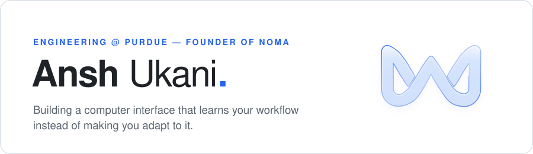

  <picture>
    <source media="(prefers-color-scheme: dark)" srcset="assets/banner-dark.svg">
    
  </picture>

  
  
  

 

### ◐ &nbsp;Now building

<table>
  <tr>
    <td width="100%">
      <h3><a href="https://nomashift.com">Noma</a> &nbsp;</h3>
      
<b>A keyboard that learns how you type.</b> Every key knows how far you pressed it, and Noma tunes each one to the way you type. Fewer missed keys, fewer accidental ones, nothing to set up.

      <ul>
        <li><b>Every key, measured</b> — a magnet in each switch and a sensor under it read the whole press, not just on or off.</li>
        <li><b>Tuned to you</b> — each key's actuation point moves to where you actually press it, and keeps adjusting when you're tired, at a new desk or on new keycaps.</li>
        <li><b>Just a keyboard</b> — plug it in on any computer. It learns on the board itself. No app, no account, no subscription.</li>
        <li><b>Built in public</b> — designed by me, in the open. Every test and every wrong turn gets shared as it happens.</li>
      </ul>
      
<a href="https://nomashift.com">Join the waitlist →</a> · <a href="https://github.com/awnsh/Noma">Repo</a>

      Before the keyboard, Noma was a desktop app (Flow + Glide) that turned repeated workflows into one-press actions. It's still in the repo.
    </td>
  </tr>
</table>

 

### ✦ &nbsp;Things I've shipped

<table>
  <tr>
    <td width="50%" valign="top">
      <h4>⌨️ &nbsp;<a href="https://awnsh.github.io/unpilot/">Unpilot</a></h4>
      
Take back the Copilot key. Describe what it should do in plain English (“act like right Ctrl”, “open Spotify”, “lock my PC”), paste one line into PowerShell, done. Mine is a Claude key.

      PowerShell · Windows · no admin rights · <a href="https://github.com/awnsh/unpilot">source</a>
    </td>
    <td width="50%" valign="top">
      <h4>📜 &nbsp;<a href="https://github.com/awnsh/fine-print">Fine Print</a></h4>
      
We read the Terms so you don't have to. A Chrome extension that sums up ToS and privacy policies in one blunt sentence, with up to five red flags — each one quoting the real line.

      TypeScript · Manifest V3 · on-device Gemini Nano · <a href="https://github.com/awnsh/fine-print">source</a>
    </td>
  </tr>
  <tr>
    <td width="50%" valign="top">
      <h4>📺 &nbsp;<a href="https://awnsh.github.io/tubestat/">TubeStat</a></h4>
      
Your YouTube life, tracked. A private Chrome extension for watch time, top creators, history, OG status and your own Wrapped.

      TypeScript · Chrome extension · <a href="https://github.com/awnsh/tubestat">source</a>
    </td>
    <td width="50%" valign="top">
      <h4>💧 &nbsp;<a href="https://awnsh.github.io/dripstat/">DripStat</a></h4>
      
How much water did your AI chats use? Estimates the footprint of your Claude, ChatGPT and Gemini conversations.

      HTML · JavaScript · <a href="https://github.com/awnsh/dripstat">source</a>
    </td>
  </tr>
</table>

 

### ✧ &nbsp;Off the keyboard

- 🏆 &nbsp;**1st in the nation, Digital Video Production** — TSA National Conference 2025 (and 1st at Pennsylvania States). I filmed and edited most of our film.
- 🔧 &nbsp;Electronics, robotics, CAD and 3D printing — the stuff that makes the Noma keyboard possible.

 

### ⚙ &nbsp;Tools I reach for

  

 

  Want to type on it first? <a href="https://nomashift.com">Get on the Noma waitlist</a>.

